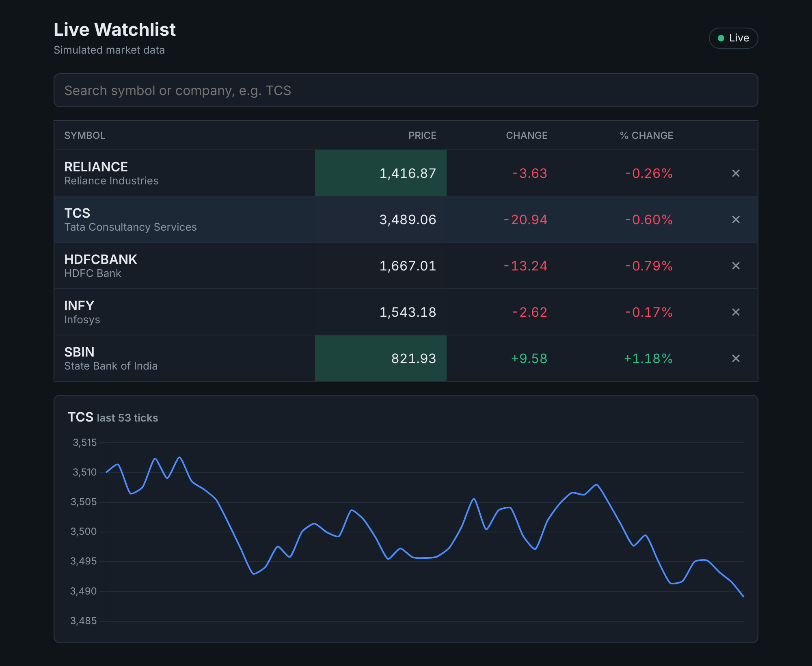

# Live Watchlist

A stock watchlist where prices update in real time over a WebSocket. Built with React and TypeScript, with a small Node server that simulates a market data feed.



> The prices are simulated. The server generates random price movements, it is not connected to a real exchange.

## Features

- Pick symbols from a dropdown or search to add them to a watchlist, remove them, and the list is saved in localStorage
- Live price, change and % change for every symbol, with a green/red flash when the price moves
- Sort by symbol, price or % change
- Click a row to see a live line chart of its recent prices (Chart.js)
- Connection status badge (connecting / live / reconnecting / offline)
- Automatic reconnect with increasing wait time, and prices are greyed out while disconnected
- Loading, error (with retry) and empty states
- Responsive layout, the table turns into cards on small screens

## Tech stack

- **Client:** React, TypeScript, Vite, Chart.js, plain CSS
- **Server:** Node.js, Express, ws
- **Tests:** Vitest, React Testing Library

## Running locally

You need Node.js 20 or newer.

Start the server:

```bash
cd server
npm install
npm start
```

Start the client in a second terminal:

```bash
cd client
npm install
npm run dev
```

Then open http://localhost:5173.

The server runs on port 4000 by default. If you change it, copy `client/.env.example` to `client/.env` and update `VITE_API_URL`.

To make the server send ticks faster (useful for testing how the UI handles a lot of updates):

```bash
TICK_INTERVAL_MS=50 npm start
```

Run the tests:

```bash
cd client
npm test
```

## How it works

### Server

`GET /api/symbols` returns the list of available symbols with their previous close price.

The WebSocket endpoint is `/ws`. The client sends the symbols it wants:

```json
{ "type": "subscribe", "symbols": ["TCS", "INFY"] }
{ "type": "unsubscribe", "symbols": ["INFY"] }
```

and the server sends one message per price change, only for subscribed symbols:

```json
{ "type": "tick", "tick": { "symbol": "TCS", "price": 3512.4, "time": 1760000000000 } }
```

### Client

The symbol list is fetched once over REST because it does not change. Prices come over the WebSocket because they change all the time and the server needs to push them.

All the WebSocket code is in one hook, `useMarketSocket`. It does three things:

1. **Subscriptions.** It compares the watchlist with what it is already subscribed to and only sends the difference, so the server never sends ticks for symbols that are not on screen.
2. **Batching.** Ticks are not put into React state one by one. They are pushed into a buffer (a ref), and a timer applies the whole buffer in one state update every 100 ms. Without this, every tick caused its own render.
3. **Reconnecting.** If the socket closes, it tries again after 1s, 2s, 4s, 8s and then every 10s. After reconnecting it subscribes to the whole watchlist again, because the new connection starts with no subscriptions.

Prices are stored in an object keyed by symbol (`{ TCS: 3512.4 }`), so updating or reading a price is a direct lookup. Each row is wrapped in `React.memo` and gets its own price as a prop, so a tick for one symbol only re-renders that row.

## Project structure

```
server/
  server.js          REST endpoint + WebSocket price feed
  symbols.js         list of symbols and starting prices
client/src/
  App.tsx            fetches symbols, puts everything together
  hooks/
    useMarketSocket.ts   WebSocket connection, batching, reconnect
    useWatchlist.ts      watchlist state + localStorage
  components/
    AddSymbolForm.tsx    search box with suggestions
    Watchlist.tsx        table, sorting, empty state
    WatchlistRow.tsx     one row (memoised)
    PriceChart.tsx       Chart.js line chart
    ConnectionStatus.tsx status badge
  utils/
    ticks.ts             pure functions for applying ticks
    format.ts            number formatting
```

## Possible improvements

- Option chain screen using the same data layer
- Connect to a real broker market data API instead of the mock server
- Virtualised list for very long watchlists
